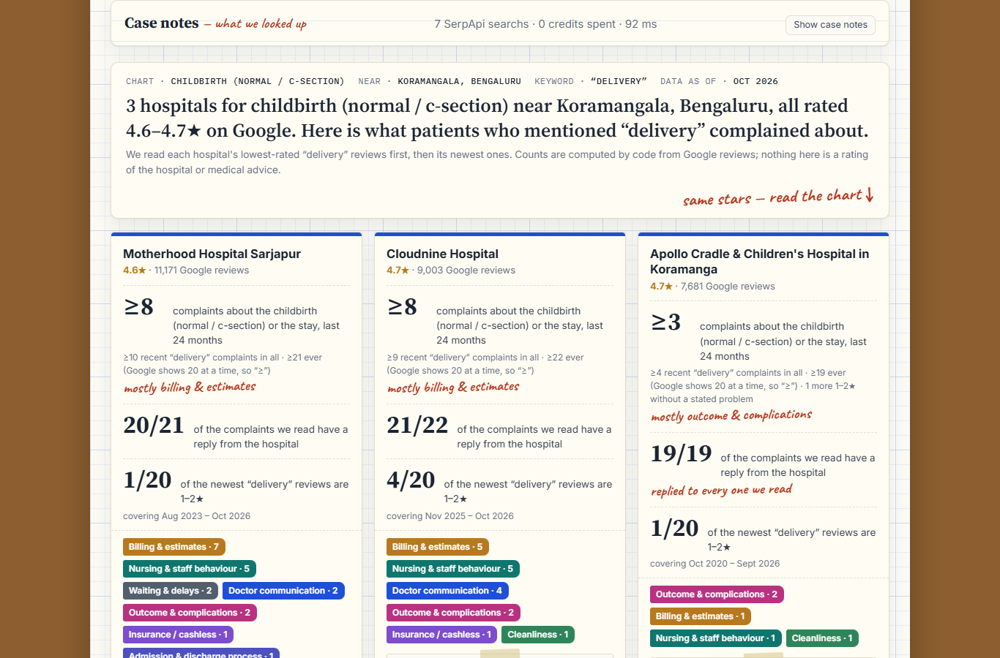
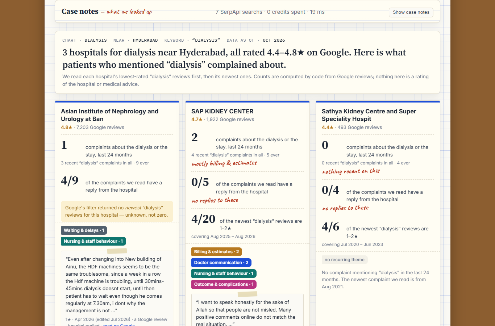

# Bedside Manner

**Same 4.7★. Different stories.** Pick a procedure (childbirth, knee replacement, cataract, dialysis…) and an area. Bedside Manner compares the most-reviewed hospitals near you by **what patients who mentioned that procedure complained about**. It shows how recently they complained, and whether the hospital replied. It then turns those complaints into questions to ask before you're admitted.

> SerpApi India Hackathon 2026 · Track: **Travel & Local Discovery** · runs locally, no deployment needed · works with **no API keys** in replay mode



---

## The problem

People choose a hospital for a planned procedure by its Google stars. Those stars blur thousands of OPD visits together, and the default review order buries what matters.

- **LocalCircles survey, 12 Aug 2026, 23,084 respondents** ([source](https://www.localcircles.com/a/press/page/private-hospital-loot)). Over 6 in 10 families had issues with private-hospital bills in the last 3 years:
  - 68% faced excessive treatment prices.
  - 56% faced excessive ICU or room charges.
  - 40% met "other unexpected or unknown charges".
  - Only 14% had no issue.
- **Default review order:** in our probe, the default order of Manipal Whitefield's reviews that mention "knee" was **20 of 20 five-star reviews**, and 17 of them thank a named doctor. Every hospital's Google page looks like that.
- **What's missing:** no existing tool shows *what patients who had your procedure complained about*, hospital by hospital, side by side.

## What you see

| | |
|---|---|
| **Headline** | "3 hospitals for childbirth near Koramangala, all rated 4.6–4.7★ on Google. Here is what patients who mentioned 'delivery' complained about." |
| **One card per hospital** | **Complaints about the procedure or the stay in the last 24 months**, shown as "≥N" when Google's 20-review page is full. **How many complaints the hospital replied to.** How many of the **newest 20** matching reviews are 1–2★, and the dates they cover. Complaint themes. Two dated excerpts with names removed, linked to Google. |
| **Ask before you admit** | Each recurring complaint theme becomes a concrete question, e.g. "Ask for a written, itemised cost estimate… what it excludes", "Get cashless pre-authorisation confirmed in writing", "…whether room rent is charged while the patient is in ICU". Each shows how many recent complaints raised it. |
| **Theme grid** | Hospitals against themes: billing, insurance, waiting, staff, doctor communication, outcome, discharge, cleanliness, emergency. |
| **Live search trail** | Every SerpApi call with its engine, purpose and time, marked "live · 1 credit" or "cached · free". |

**The interface is a patient chart on a clipboard.** Each hospital is a chart column of "vitals" with handwritten margin notes computed from the counts ("mostly billing & estimates", "replied to every one we read"). Complaint themes are colour-coded chart tabs, and the questions form a tickable pre-admission checklist. Motion is light CSS/SVG: an ECG trace, and paper slips for the quotes.

**It never rates, ranks or recommends a hospital.** Google's star rating is shown only as context. A low-star review that raises no problem is not counted as a complaint. If Google's review filter returns nothing, the app says **"unknown"**, not "no complaints".



## How it works

```
procedure + area ─ google_maps   "<procedure> hospital in <area>, <city>"
                   → hospitals only: no doctors' own listings, no clinics, ≥200 reviews, one branch per group, top 3
                 ─ google_maps_reviews ×2 per hospital, the SAME keyword for every hospital (e.g. "delivery"):
                      sort=ratingLow   → the 20 lowest-rated reviews that mention it
                      sort=newestFirst → the 20 newest reviews that mention it
                 ─ Gemini 2.5 Flash, one batched call: for each 1–2★ review → about the procedure/stay or only
                   an OPD visit + which complaint themes it raises (labels only; keyword rules if no LLM)
                 → counts, reply rates, date windows, name-redacted excerpts, "ask before you admit": all code
```

### SerpApi engines, and why each is load-bearing

| Engine | Call | What it gives Bedside Manner | Without it |
|---|---|---|---|
| `google_maps` | `type=search`, `q="<procedure> hospital in <area>, <city>"`, `ll`=city, `gl=in` | The hospitals people actually choose between, with ratings, review counts, types and `data_id` | Nothing to compare |
| `google_maps_reviews` | `data_id`, `query=<keyword>`, `sort_by=ratingLow`, `num=20` | The lowest-rated reviews that mention the procedure: complaints, dates, owner responses, review links | No complaints, no reply rate |
| `google_maps_reviews` | same, `sort_by=newestFirst` | What the most recent patients said: the newest-20 snapshot and the date span it covers | No recency view |

Each comparison costs 1 + 3 × 2 = **7 credits**, and results are cached for a week. SerpApi's own cache makes identical searches within an hour free.

### Design choices that came from checking real data

| Problem found | What the app does |
|---|---|
| A different keyword per hospital ("knee" for one, "surgery" for another) manufactured a contrast that wasn't there (skeptical-judge review) | One keyword per comparison, for every hospital |
| Google returns at most 20 reviews per page | When all 20 are complaints, counts show as "≥" |
| Google's keyword filter sometimes returns nothing for a hospital that clearly has such reviews (Aster Whitefield + "knee") | Shown as "unknown", never as zero |
| A 2★ review can be praise ("my father full satisfied, thank you all") | A complaint must raise an issue |
| Maps results mix hospitals with doctors' SEO listings ("Dr … \| Best Orthopaedic Surgeon in …", 4.9–5★) and several branches of one group | Doctor listings and clinics are skipped, one branch per group is kept, and every skip is listed with its reason |
| Negative reviews name doctors and nurses | Names after titles and roles ("Dr", "Sister", "physiotherapist") and after "consultation by…" are replaced with "[name]". Excerpts are capped at 2 sentences, dated (with edit date) and linked |

## Verified against the web

Four comparisons were run on live data. An independent agent then fact-checked them on the web and sampled the LLM labels. The full log, and the 16 bugs that verification, review and testing found, are in [docs/VERIFICATION.md](docs/VERIFICATION.md).

| Comparison | Hospitals (Google ★) | Recent procedure complaints* | Checked | |
|---|---|---|---|---|
| Childbirth · Koramangala, Bengaluru | Motherhood Sarjapur 4.6 · Cloudnine Jayanagar 4.7 · Apollo Cradle 4.7 | ≥8 · ≥8 · ≥3, mostly billing and staff behaviour; replies 20/21 · 21/22 · 19/19 | Real maternity hospitals; ratings confirmed; excerpt dates match the text | ✅ |
| Cataract · Chennai | Dr Agarwals 4.9 · Satish 5.0 · The Eye Foundation 4.9 | 1 · 1 · 0 | Dr Agarwals was wrongly skipped as a "doctor listing" in the first run (fixed). A 2★ review that is praise is not counted | ✅ after fix |
| Dialysis · Hyderabad | AINU 4.8 · SAP Kidney Center 4.7 · Sathya Kidney Centre 4.4 | 1 · 2 · 0. AINU's newest-first search came back empty, shown as **unknown** | AINU rating consistent with an aggregator; hospital selection fixed | ✅ after fix |
| Knee replacement · Whitefield, Bengaluru | Manipal 4.7 · Svastha 3.8 · Medicover 5.0 | 0 · 0 · 0 (Manipal's 4 older complaints from 2022 were all replied to) | Doctors' SEO listings correctly skipped; Medicover kept despite Google typing it "clinic" | ✅ |
| Name redaction | — | "[name]" in excerpts | Two lowercase names leaked in the first run (fixed); rescan of every shown excerpt is clean | ✅ after fix |
| LLM labels (24 sampled) | — | scope + themes | ~12% clear errors (e.g. an OPD complaint labelled as about the procedure) | ⚠️ |

\*1–2★ reviews that raise a problem, about the procedure or the stay, posted in the 24 months before the data was fetched. "≥" means Google's 20-review page was full of 1–2★ reviews.

## Quick start

Requires [uv](https://docs.astral.sh/uv/) (Python 3.12 is pinned).

```bash
git clone https://github.com/LoheshM/bedside-manner && cd bedside-manner
uv sync
uv run uvicorn app.main:app --port 8000
# open http://localhost:8000 and click an example
```

**No keys needed** to try it. Without `SERPAPI_API_KEY` the app runs in **replay mode** on four recorded comparisons in `data/fixtures/`, scrubbed of the key: childbirth in Koramangala, cataract in Chennai, dialysis in Hyderabad and knee replacement in Whitefield.

For live comparisons, copy `.env.example` to `.env` and add:
```
SERPAPI_API_KEY=...   # https://serpapi.com (free plan: 250 searches/month)
GEMINI_API_KEY=...    # https://aistudio.google.com/apikey (optional; without it themes come from keyword rules)
```

- **Command line:** `uv run python -m scripts.check delivery Koramangala Bengaluru`
- **Tests:** `uv run pytest -q` (772 offline tests: respx blocks the network and keys are removed)
- **Lint:** `uv run ruff check`
- **Secret scan:** `uv run python -m scripts.secret_scan`

## Limitations (honest)

- **These are Google reviews, not clinical outcomes.** They are self-selected and sometimes old or one-sided, and some hospitals collect positive reviews from discharged patients. Treat every count as "what reviewers said", never as a quality measure.
- **One keyword, at most 20 reviews per sort.** "delivery" also catches OPD and report-delivery complaints; the LLM's "about the procedure or stay" label separates those, but it can be wrong. Spot-check the excerpts, which link to Google.
- **Google's keyword filter is a black box.** It sometimes returns nothing (shown as unknown), and newest-first and lowest-first can disagree.
- **Coverage:** the three most-reviewed hospitals in Google's top 20 Maps results. Smaller or newer hospitals, and doctors' own listings, aren't compared.
- **Redaction is rule-based** and can miss a name written in an unusual way (e.g. the second name in "checked by Priya and Kumar").
- **LLM labels are imperfect:** about 12% of sampled labels were clearly wrong (mostly OPD vs procedure scope). Counts by theme are indicative; the excerpts link to the source.

## AI tools disclosure

- **Built with Claude Code** (Anthropic): research agents, an adversarial "skeptical judge" critique, code, tests, code and security review, and web verification. All decisions and results were checked by running the app on live data.
- **In the product:** Google **Gemini 2.5 Flash**, through its OpenAI-compatible endpoint. It labels each 1–2★ review's scope and complaint themes from a fixed list. It produces no numbers, scores or prose that the app shows as fact.

## Licence

MIT. See [LICENSE](LICENSE).
